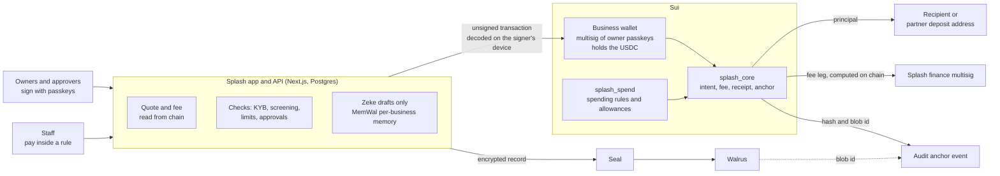

# Splash Finance

**A business wallet for paying suppliers across Southeast Asia in stablecoin, built on Sui.**
A business holds its own USDC, a person on the team signs every payment, and each payment leaves a sealed, verifiable record. Splash is software. It holds no key to a business's wallet and cannot move a business's money.

> **Status: v2 is built and tested on a test network. It is not live on mainnet.** Nothing here has handled real customer money. [What is proven and what is not](#what-is-proven-and-what-is-not) is stated plainly below.

## What it does

- **Pay a supplier's bank account, another Splash business, or a Sui wallet** from the business's own wallet, with one clear approval step and a receipt.
- **Pay many at once.** Upload a sheet, review every row (clear, check, or cannot be paid), approve once.
- **Let staff pay inside a rule.** An owner sets who may pay whom, how much, and how often. Anything outside the rule goes to the owners.
- **Schedule payments.** Either Splash prepares them and the owners approve each run, or the owners sign one allowance and runs pay automatically inside its limits, with a warning window and Skip and Stop buttons.
- **Keep proof.** Every settlement writes an encrypted record to Walrus and anchors its hash on Sui, so an auditor can check it later.
- **Ask Zeke.** An AI assistant that reads, explains and prepares drafts. It cannot sign or send.

## How it works



One payment, in plain steps:

1. The app quotes the payment. The fee comes from an on-chain config, never above 1%, and the fee shown is the most the signer can be charged.
2. The app builds the transaction. Each signer's own device decodes it, shows what it will do, and asks for a passkey signature. The app never signs for the business.
3. One Sui transaction pays the recipient, takes the fee, returns anything left to the business wallet, and records an audit anchor. The anchor cannot be skipped: the receipt object has no abilities, so the transaction fails unless it is consumed.
4. The app writes the sealed evidence record to Walrus and keeps the receipt.

## The pieces

### On chain (`move/`)

| Package | What it does | State |
|---|---|---|
| `splash_core` | Business accounts, payment intents, the fee config, the address registry, receipts and the audit anchor. Holds no client value: no struct in it can hold a `Balance`, and `npm run lint` fails if one appears. | Mainnet package. Upgradable, additive only, behind a 24-hour delay. Not yet published to mainnet. |
| `splash_spend` | Spending rules (`SpendPolicy`), staff payments, owner second approval, allowances. Re-checks the 1% fee ceiling. | Mainnet package, immutable. Not yet published to mainnet. |
| `splash_upgrade_delay` | Holds core's upgrade capability: 24 hours' notice, then a 7-day window. | Mainnet package, immutable. Not yet published to mainnet. |
| `splash_custody`, `splash_meter` | The v1 pooled-funds design. | Retired from the mainnet path. Test network only. |

Fee kinds are derived on chain from where the money goes: Splash business to Splash business is free; a wallet, an exchange, another chain and a bank payout each have a published rate schedule. Fees stay off until governance applies a fee recipient after 24 hours' notice. See [`docs/v2/fees.md`](./docs/v2/fees.md) and [`docs/v2/phase1-move-design.md`](./docs/v2/phase1-move-design.md).

### App and API

- **Next.js 16** (App Router, React 19, TypeScript) with **PostgreSQL** through Drizzle. About 100 tables across 88 migrations.
- **Business wallet:** a Sui multisig of the owners' passkeys, 2-of-N by default. Roles are owner, approver, staff and viewer; a Finance lead is an appointment.
- **Limits:** a new business starts at 50,000 USDC per payment and 100,000 a day, with the monthly figure worked out from three onboarding answers. These are starting points. Owners lower limits instantly; raising them goes to Splash staff with 24 hours' notice, and two staff for large grants. See [`docs/v2/phase3-limits.md`](./docs/v2/phase3-limits.md).
- **When nobody approves:** approvers are reminded at 10 minutes, 1 hour and 4 hours, then the request lapses unpaid. Nothing is ever approved by default, by a timer or by Splash.
- **Automatic payments:** run through a dedicated key held in AWS KMS, separate from the key that sponsors gas. A stolen key is bounded by the allowances owners signed. See [`docs/v2/phase3-scheduled-batches.md`](./docs/v2/phase3-scheduled-batches.md).
- **Exchange payments:** a Travel Rule message must be accepted before signing. The message names the sender as "Sent by Name (Title)" unless the business or the person chose to share only the company name. The audit record always keeps who started and who approved.
- **Team:** invitations by email, member titles, leaving a business with owner approval, "Declined by" labels that survive someone leaving. See [`docs/v2/phase3-team-roles.md`](./docs/v2/phase3-team-roles.md).
- **Phone and accessibility:** a dedicated phone layout for Home, Transfer, Approve, Wallet and Zeke; contrast of 4.5:1 is checked by tests.

### Evidence: Walrus and Seal

For each wallet payment the server builds a canonical record (who started it, who could approve, the route, the rule, the payee, the amount, the fee bound). The record is encrypted with **Seal** and stored on **Walrus**. The Sui transaction anchors the record's hash and the blob id in the `SettlementAnchored` event, and each later signature or decline becomes its own sealed record tied to the first. Once a day a Merkle root over the day's settlements is sealed, stored and anchored.

An auditor can recompute the hash from the stored blob and compare it with the chain (`/api/audit/[intentId]`, the audit page, `scripts/verify-commitment.mjs`). Events on chain carry a commitment, not payment data.

Be clear about the limits: the encryption policy is currently one global policy and the operator key can decrypt any sealed record (finding A-13 in [`SECURITY.md`](./SECURITY.md)), and the committed Seal configuration has no key servers yet, so production refuses to seal until a committee is configured.

### Zeke and MemWal

**Zeke** reads balances, rates, invoices and recipients, and drafts payments, batches and treasury moves. It has no signer, no approval call and no tool that submits anything; a startup check and a test enforce that. A deterministic guard removes any sentence claiming money was sent. Invoice and spreadsheet text is treated as untrusted: payee and amount never come from it.

**MemWal** is Zeke's memory. It is scoped to one business and stores only two things: the assistant's name, and invoice vendor names with their settlement currency. The "What MemWal stores" card in the app lists what is stored and what is never stored (invoice files, amounts, bank details, account numbers, KYB documents).

## What is proven and what is not

**Proven**
- 3,922 Node tests pass on the integration branch, and 88 migrations apply once, in order, on an empty database.
- The Move packages were exercised on Sui testnet on 24 and 25 October 2026: publishing, a 2-of-3 wallet, wallet and staff payments, owner-approved and executor payments, and refusals of a duplicate reference, a spend without approval and a spend before activation. A wallet payment and a 99 USDC bank payout both charged the fee on chain.
- Invariants are checked on every `npm run lint`: no value in core, one 1% fee ceiling in three places, copy and number rules, migration order.

**Not proven**
- Nothing is published to mainnet and no mainnet key has been handled.
- Passkeys on testnet were software passkeys. The hardware 2-of-3 check is still owed, and business wallets stay off mainnet in code until it is recorded.
- Every payout, funding, compliance and exchange partner is a sandbox. In production each refuses until it is connected.
- The independent Move review is not yet done.
- Automatic payments, sponsored gas and the batch flow have not been run against a real network or real KMS.
- Tests run on an in-process Postgres, not a multi-connection one.

[`docs/v2/`](./docs/v2) holds the detail, and [`SECURITY.md`](./SECURITY.md) lists the open findings.

## Run it locally

You need Node 24.11 or later (below 25), npm 11, and for the Move packages the Sui CLI `mainnet-v1.82.3`.

```bash
npm install
npm run dev:db     # in-process Postgres on port 5433, runs every migration, seeds demo accounts
npm run dev        # http://localhost:3000
```

`dev:db` prints the demo accounts when it starts. The first page you open compiles slowly on some drives; later loads are fast. Copy [`.env.example`](./.env.example) to `.env.local` for anything beyond the defaults. Every variable the code reads is declared there, and `npm run check:env` fails if the two drift. Do not commit `.env.local`.

Checks:

```bash
npm run lint              # sixteen invariant checks, then eslint
npx tsc --noEmit -p .
npm test
npm run build
```

Move packages (each builds from its own directory; there is no root `Move.toml`):

```bash
cd move/splash_core          && sui move build && sui move test
cd move/splash_spend         && sui move build && sui move test
cd move/splash_upgrade_delay && sui move build && sui move test
```

Database migrations on a real database run once, before deploy, with `npm run db:migrate:run`. Read [`docs/v2/migrations.md`](./docs/v2/migrations.md) first: migration 0080 drops six unused tables and loses their rows.

## Repository map

| Path | What is there |
|---|---|
| `move/` | The Sui packages and their tests |
| `app/` | Next.js routes: dashboard, wallet, approve, admin console, public receipt, API and cron routes |
| `components/` | Screens and shared UI |
| `lib/` | Money, fees, wallet, limits, schedules, team, compliance, evidence (Walrus, Seal), Zeke and MemWal |
| `drizzle/` | Migrations and their journal |
| `tests/` | Node tests |
| `scripts/` | The invariant checks, the migration runner, the dev database |
| `experiments/v2-phase1/` | The testnet end-to-end script and its recorded results |
| `docs/v2/` | The v2 design and per-feature notes |

## More reading

- [`docs/v2/phase1-move-design.md`](./docs/v2/phase1-move-design.md): the on-chain design and its review.
- [`docs/v2/fees.md`](./docs/v2/fees.md): fee kinds, rates, governance.
- [`docs/UPGRADE-POLICY.md`](./docs/UPGRADE-POLICY.md) and [`docs/KEY-POLICY.md`](./docs/KEY-POLICY.md): who holds which key and how upgrades work.
- [`docs/MAINNET-CHECKLIST.md`](./docs/MAINNET-CHECKLIST.md): what must be true before mainnet.
- [`docs/commitments.md`](./docs/commitments.md): the commitment scheme behind the audit anchor.
- [`SECURITY.md`](./SECURITY.md): findings, their status, and the threat notes.

## Security

Report a vulnerability privately to the maintainers; do not open a public issue. There is no licence file in this repository yet, so ask the maintainers before reusing the code.
